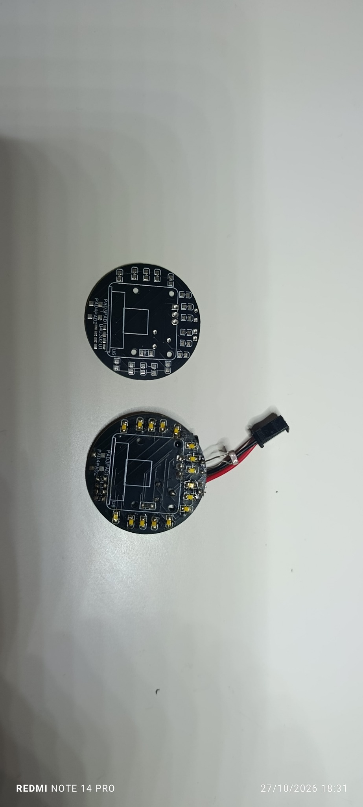
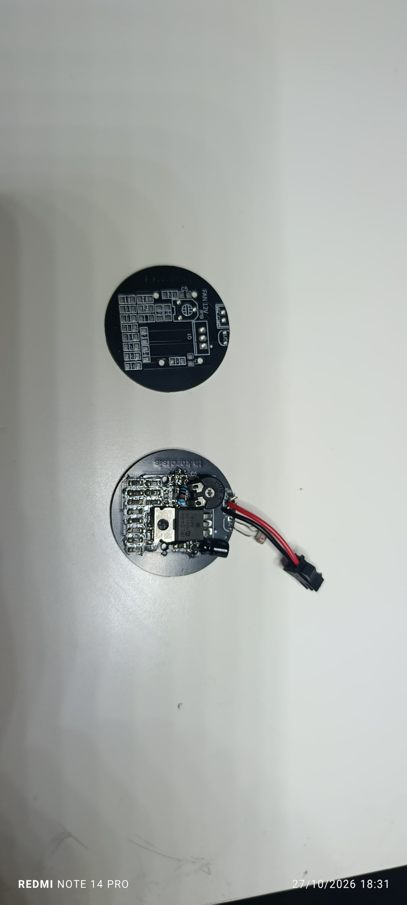
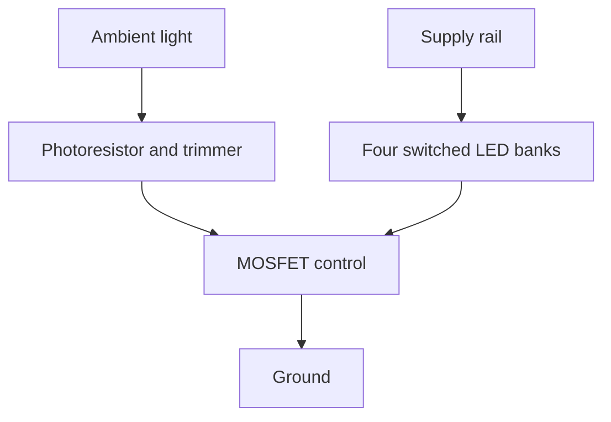

# IMX219 Camera Ring Light

**A compact, ambient-light-responsive LED board designed around the Raspberry Pi Camera Module v2.**

Designed by **Thanos Karatsis · Karatsis Electronics**. Manufactured and tested by the designer; measured performance data and the test procedure have not yet been published.

[Hardware overview](docs/HARDWARE.md) · [Build notes](docs/BUILD.md) · [Manufacturing files](manufacturing/) · [Usage terms](LICENSE.md)

> **Supply: 5 V DC.** The designer confirms testing at 5 V, consistent with the schematic. The photographed “FAN 12V” marking is not the operating supply rating; do not use it as an instruction to apply 12 V.

## Designed for close-up illumination

Sixteen warm-white LEDs surround the camera mounting area. Four switched groups let the user select active LED banks. A photoresistor and adjustable trimmer control a MOSFET stage to vary illumination with ambient light, without a microcontroller or firmware in the supplied circuit.

| Feature | Design information |
| :--- | :--- |
| Camera reference | Raspberry Pi Camera Module v2 / IMX219 |
| Lighting | 16 LEDs, four groups of four |
| LED selection | 0805 warm-white LEDs; designer-supplied supplier link below |
| Control | Photoresistor, trimmer and IRLZ44 MOSFET |
| Supply | 5 V DC; tested at 5 V by the designer |
| Hardware status | Manufactured and tested, as reported by designer |
| Public release | Gerber/drill archive, photographs and documentation |
| License | Personal, noncommercial use; commercial permission required |

## Physical prototype

| LED side | Component side |
| :---: | :---: |
|  |  |

Original photographs supplied by the designer. Each shows a bare PCB and an assembled prototype. The camera module is not fitted in these photographs.

## How it works

This is a functional overview, not a wiring diagram. Exact switching threshold and optical output depend on the photoresistor, adjustment and LED characteristics.

## Make a personal copy

1. Read the [usage terms](LICENSE.md) and [build notes](docs/BUILD.md).
2. Confirm outstanding component details with the designer.
3. Download the original ZIP from [manufacturing](manufacturing/). Its Gerber and drill files are unchanged.
4. Inspect the fabrication preview and select manufacturing settings appropriate to the design; the original order specifications are not supplied.

**LEDs used:** [Grobotronics — LED 0805 SMD White Warm Clear](https://grobotronics.com/led-0805-smd-white-warm-clear.html). The designer identifies this listing as the installed part; electrical ratings have not been independently verified. The photoresistor's exact part number is unknown.

## Ownership and permissions

© 2026 Thanos Karatsis — Karatsis Electronics.

Personal, noncommercial fabrication and use of the unmodified released design are permitted under [LICENSE.md](LICENSE.md). Commercial manufacture, sales, business use and commercial integration require prior written permission. Request permission by opening an issue addressed to the repository owner; a request is not approval.

This is a restricted hardware release, **not an open-source hardware release**. Editable CAD, the detailed schematic, PCB PDF and OBJ source are intentionally not distributed. Public Gerbers still reveal the board layout and enable reproduction; no technical copy protection is claimed.

Raspberry Pi and other product names identify compatibility targets only; no affiliation or endorsement is claimed.
